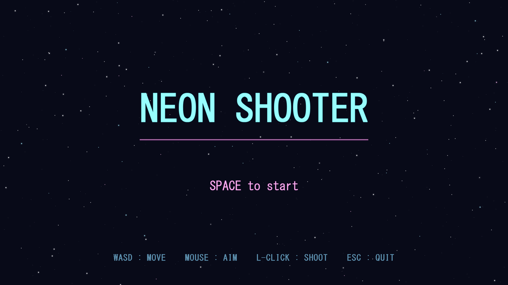
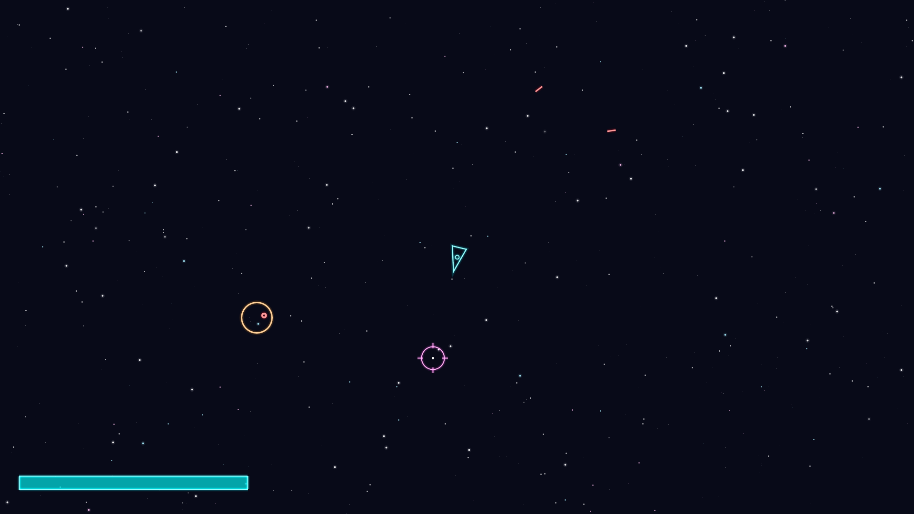
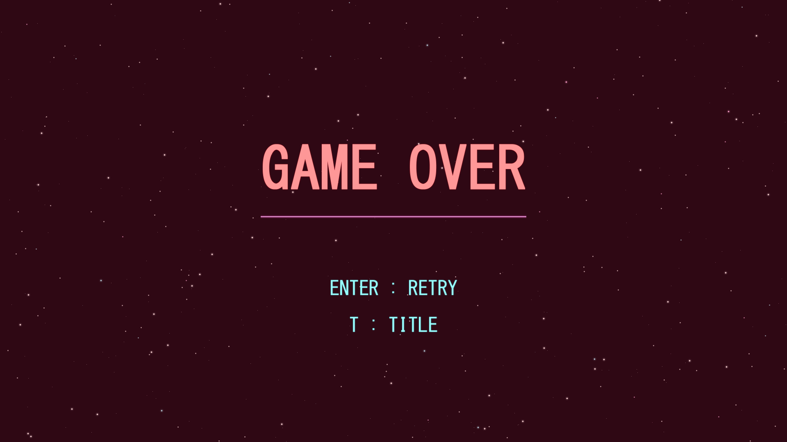

# GALAXY WAR

ネオン風の見た目の、見下ろし型2Dシューティングゲームです。
広いステージを動き回りながら、追いかけてくる敵をマウスで狙って倒します。

## スクリーンショット

| タイトル | ゲーム中 | ゲームオーバー |
|:---:|:---:|:---:|
|  |  |  |

## 操作方法

| 操作 | キー |
|---|---|
| 移動 | W A S D / 矢印キー |
| 照準 | マウス |
| 射撃 | 左クリック |
| ゲーム開始 | SPACE(タイトル画面) |
| リトライ | Enter(ゲームオーバー画面) |
| タイトルへ戻る | T(ゲームオーバー画面) |
| デバッグ表示の切り替え | F1 |
| 終了 | ESC |

## 工夫したところ

### 新しいシーンを簡単に追加できる設計
タイトル・ゲーム中・ゲームオーバーの各画面は、共通の基底クラス `Scene`(`Initialize` / `Update` / `Draw`)を継承して作っています。
新しい画面を追加したいときは、`Scene` を継承したクラスを1つ作り、`GameScene` に切り替え用の関数を足すだけでゲームに組み込めます。

### unique_ptr によるメモリ管理
現在のシーンは `std::unique_ptr<Scene>` で管理しています。
シーンを切り替えると前のシーンは自動で解放されるので、`delete` の書き忘れによるメモリリークが起きない作りにしました。

## その他の機能

- 3層の星空背景(カメラの動きに合わせた視差スクロール)
- カメラ追従スクロール(画面 960×540、ステージ 3840×2160)
- プレイヤーを追いかけながら弾を撃ってくる敵
- HP バーと被弾後の無敵時間
- 60FPS 固定のゲームループ

## 開発環境

- 言語:C++
- ライブラリ:DXライブラリ 3.24f
- IDE:Visual Studio

## ビルド方法

1. [DXライブラリ](https://dxlib.xsrv.jp/) の Visual C++ 用(3.24f)をダウンロードし、`C:\Dxlib\DxLib_VC3_24f\` に展開します。
   (プロジェクトは `C:\Dxlib\DxLib_VC3_24f\DxLib_VC\プロジェクトに追加すべきファイル_VC用` を参照しています)
2. `GAME.slnx` を Visual Studio で開きます。
3. 構成を `x64` にしてビルド・実行します。

## 制作情報

- 制作期間:約2か月
- 制作人数:1人(個人制作)

## 今後やりたいこと

- 敵の種類を増やす
